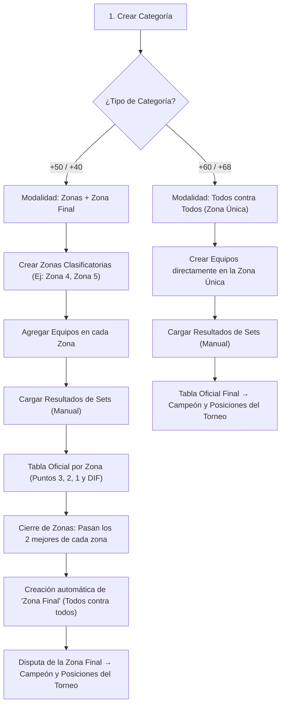

# Documentación Técnica Integral — PuntajeNewcom

> **Aplicación para la Gestión y Seguimiento de Torneos de Newcom**  
> Formato oficial: Federación Chubutense de Voleibol (FE.CHU.VOL.) / Malvinas Argentinas, Chubut.  
> Versión del Esquema: **v2** | Arquitectura: **Vanilla JS + Clean/Hexagonal Architecture**

---

## 1. Visión General del Proyecto

**PuntajeNewcom** es una plataforma web desarrollada en JavaScript puro (Vanilla JS), HTML5 y CSS3, diseñada para administrar torneos de newcom sin requerir servidores externos, bases de datos remotas ni herramientas de compilación (*bundlers* como Webpack o Vite).

### Principios Fundamentales de Diseño
1. **Cero Dependencias Externas:** No utiliza frameworks pesados (React, Angular o Vue) ni librerías de terceros en tiempo de ejecución. Puede ejecutarse abriendo directamente `index.html` en cualquier navegador moderno.
2. **Persistencia Local Segura (Web Storage):** Todo el estado se almacena en el `localStorage` del cliente bajo la clave `'puntaje-newcom-state'`, con validación de esquemas, copias de seguridad automáticas y capacidad de recuperación ante corrupción de datos.
3. **Carga Manual Guiada (Sin Fixtures Automáticos):** El sistema no asume calendarios fijos ni genera emparejamientos automáticos que restrinjan la mesa de control; los partidos se registran a medida que se juegan en cancha, validando los tanteadores reales set a set.
4. **Reglamento Oficial de Puntuación (3, 2 y 1):**
   * **Victoria 2–0:** 3 puntos al ganador, 1 punto al perdedor.
   * **Victoria 2–1:** 2 puntos al ganador, 1 punto al perdedor.
   * *Presentación/Participación:* El equipo perdedor siempre acumula 1 punto por partido jugado.
5. **Criterios Estrictos de Desempate en Cascada:**
   La tabla ordena prioritariamente por Puntos de Clasificación acumulados. Únicamente ante empate en puntos se aplican:
   1. Mayor Diferencia de Tantos (`DIF = PF - PC`).
   2. Mayor cantidad de Puntos a Favor (`PF`).
   3. Menor cantidad de Puntos en Contra (`PC`).
   4. Enfrentamiento directo (*Head-to-Head*) entre los equipos involucrados.
   5. Criterio determinista final (orden alfabético / id).

---

## 2. Arquitectura del Código

El repositorio presenta una estructura dual altamente desacoplada:

```
PuntajeNewcom2026/
│
├── index.html                                 # Punto de entrada Web (SPA Host)
├── app.js                                     # Cliente Frontend Monolítico Reactivo (UI + State)
├── styles.css                                 # Sistema de diseño, temas y hojas de estilo oficiales
├── Presentacion_Torneo_Aguilas_Doradas.pdf    # Dossier informativo oficial en PDF para el club
│
├── src/                                       # Capas modulares de Clean Architecture (UMD)
│   ├── domain/                                # Reglas puras del negocio (sin DOM ni I/O)
│   │   ├── constants.js                       # Constantes, etapas, estados y formatos
│   │   ├── errors.js                          # Errores tipados del dominio (DomainError)
│   │   ├── scoring.js                         # Reglas de tanteador, sets y puntos
│   │   ├── standings.js                       # Cálculo de tablas, cocientes y desempates
│   │   └── tournament.js                      # Progresión de zonas, clasificados y modalidades
│   │
│   ├── infrastructure/                        # Adaptadores técnicos de persistencia
│   │   ├── state-schema.js                    # Normalización, saneamiento y migración (v1 → v2)
│   │   └── local-storage-repository.js        # Repositorio sobre Web Storage con backups
│   │
│   └── application/                           # Casos de uso y orquestación
│       └── tournament-service.js              # Fachada transaccional atómica (commit/rollback)
│
└── tests/                                     # Suite de pruebas automatizadas deterministas
    └── helpers.js                             # Utilidades y generador de datos para node:test
```

### ¿Por qué existe `app.js` junto a `src/`?
* **`app.js`** es el cliente web para el usuario final en el navegador. Empaqueta el ciclo de vida de la UI, la manipulación reactiva del DOM (`scoreboard`, inputs dinámicos de sets, modal flotante) y la sincronización con el usuario en un único archivo sin necesidad de transpiladores.
* **`src/`** implementa el núcleo formal del sistema bajo **Arquitectura Limpia / Hexagonal**, utilizando el patrón **UMD (Universal Module Definition)**. Esto permite ejecutar la lógica de negocio y las pruebas en Node.js de forma aislada, o integrarla como librería en microservicios o backends futuros.

---

## 3. Detalle Exhaustivo de Carpetas y Archivos

### 3.1. Raíz del Proyecto

#### [`index.html`](file:///home/jeremiasreinoso/Escritorio/Proyectos%20de%20programacion%20/PuntajeNewcom2026/index.html)
* **Propósito:** Contenedor HTML principal y punto de montaje de la Single Page Application (SPA).
* **Estructura:**
  * Define la etiqueta `<meta name="viewport">` para soporte responsive en dispositivos móviles y tablets.
  * Vincula la hoja de estilo [`styles.css`](file:///home/jeremiasreinoso/Escritorio/Proyectos%20de%20programacion%20/PuntajeNewcom2026/styles.css).
  * Provee el nodo `<div id="app"></div>` donde el motor de plantillas de `app.js` renderiza las vistas.
  * Incluye el contenedor `<div id="modal" class="modal" hidden></div>` para diálogos emergentes (creación de categorías, confirmación de clasificados, confirmación de eliminación).
  * Carga [`app.js`](file:///home/jeremiasreinoso/Escritorio/Proyectos%20de%20programacion%20/PuntajeNewcom2026/app.js) al final del body para garantizar que los nodos estén disponibles.

#### [`styles.css`](file:///home/jeremiasreinoso/Escritorio/Proyectos%20de%20programacion%20/PuntajeNewcom2026/styles.css)
* **Propósito:** Sistema de diseño completo y responsivo con soporte para modo claro (*light*) y modo oscuro (*dark*).
* **Módulos visuales principales:**
  * **Variables CSS (`:root` y `[data-theme="dark"]`):** Paleta institucional de FECHUVOL / Malvinas Argentinas (verde esmeralda `--green: #1f8a65`, naranja coral `--accent: #eb6549`, fondos neutros y grises de contraste).
  * **Layout General (`.app`, `.sidebar`, `.main`, `.topbar`):** Navegación lateral fija en escritorio y transformable en barra de pestañas scrollable horizontal en pantallas móviles (`@media (max-width: 680px)`).
  * **Stepper de Flujo (`.workflow-stepper`):** Pestañas visuales numeradas (1. Zonas y Equipos, 2. Cargar resultado, 3. Posiciones, 4. Partidos Jugados).
  * **Marcador Reactivo de Carga (`.scoreboard`, `.set-row`, `.set-cell`):** Entradas numéricas gigantes (`52px`) para sets, badges de sets ganados que se iluminan en verde al definir un ganador y fila condicional para Set 3 (desempate).
  * **Planillas Oficiales de Posiciones (`.official-positions-table`):** Encabezados verdes agrupados por bloques (PUNTOS, PARTIDOS, SET, TANTOS, RESULTADOS, COCIENTES) con alineaciones y colores reglamentarios exactos.
  * **Planilla de Partidos (`.official-matches-table`):** Presentación a 2 filas por partido (ganador resaltado en verde arriba, perdedor abajo) con marcadores por set y botón de reversión.
  * **Banners de Acción y Alertas (`.live-preview-banner`, `.toast-undo`, `.notice`):** Retroalimentación visual en tiempo real mientras el operador tipea.

#### [`app.js`](file:///home/jeremiasreinoso/Escritorio/Proyectos%20de%20programacion%20/PuntajeNewcom2026/app.js)
* **Propósito:** Motor de aplicación cliente para el navegador. Administra el estado global, las transiciones de pantalla, la validación del formulario de partidos y la renderización de tablas oficiales.
* **Componentes y funciones clave:**
  * **Estado y ciclo de vida:** `loadState()`, `saveState()`, `normalize()`, `empty()`. Deserializa el JSON de `localStorage`, lo valida contra anomalías y purga datos de demostración antiguos.
  * **Gestión de Entidades:**
    * Categorías: `createCategory(name, format)`, `editCategory(id, name)`, `deleteCategory(id)`, `selectCategory(id, next)`.
    * Zonas: `createZone(name)`, `renameZone(id, name)`, `deleteZone(id)`, `assignTeamToZone(teamId, zoneId)`, `removeTeamFromZone(teamId, zoneId)`.
    * Equipos: `createTeam(name, zoneId)`.
  * **Reglas de Puntuación:**
    * `resultPoints(score)`: Devuelve `{ winner: 3, loser: 1 }` para `'2-0'` y `{ winner: 2, loser: 1 }` para `'2-1'`.
    * `headToHeadDiff(aTeamId, bTeamId, matches)`: Determina victorias directas entre dos rivales para resolver empates.
    * `sameRanking(a, b, matches)`: Comprueba si dos filas empatan exactamente en Puntos, DIF, PF, PC y cruce directo.
    * `standings(categoryId, stage, zoneId)`: Genera las filas de posiciones y las ordena según los 5 criterios reglamentarios.
  * **Scoreboard Reactivo y Carga Manual:**
    * `initLoaderDraft(c, preferredZoneId)` y `ensureLoaderDraft(c)`: Inicializan el borrador del partido.
    * `evaluateScoreboard(c, draft)`: Evalúa en memoria los sets ingresados. Detecta automáticamente si hay ganador 2–0, si se requiere el Set 3 de desempate (1–1) o si los marcadores son inválidos/empatados.
    * `syncScoreboardDOM(c)`: Actualiza en vivo el DOM sin redibujar toda la página. Habilita o deshabilita el botón `#save-result-btn`.
    * `saveScoreboardMatch(c, draft)`: Persiste el partido registrado y lanza un toast de deshacer (*undo*).
  * **Vistas del Sistema (`render()`):**
    * `home()`: Panel general con métricas globales y listado de categorías.
    * `zonesPage()`: Gestión de zonas clasificatorias y equipos.
    * `resultsPage()`: Formulario con selector de zona, equipos y marcador dinámico de sets.
    * `positionsPage()`: Renderiza las planillas oficiales de posiciones por zona (`renderZoneStandingsSheet`).
    * `matchesPage()`: Historial completo de partidos jugados con filtros por zona y fase, y opción de edición y borrado.
  * **API Global en Ventana:** Expone el objeto `window.PuntajeNewcom` para depuración o scripts auxiliares desde la consola del navegador.

#### [`Presentacion_Torneo_Aguilas_Doradas.pdf`](file:///home/jeremiasreinoso/Escritorio/Proyectos%20de%20programacion%20/PuntajeNewcom2026/Presentacion_Torneo_Aguilas_Doradas.pdf)
* **Propósito:** Documento formal imprimible y exportable para presentar la plataforma a la comisión directiva del club Águilas Doradas y a las autoridades arbitrales.
* **Contenido:** Describe el flujo operativo del torneo, la reglamentación 3-2-1, el esquema de zonas clasificatorias y zona final, y capturas esquemáticas de las planillas oficiales.

---

### 3.2. Carpeta `src/domain/` (Capa de Dominio)

Esta capa contiene la lógica esencial del deporte y las reglas del torneo. Está compuesta exclusivamente por **funciones puras** y clases de error, sin dependencias de interfaces de usuario ni mecanismos de almacenamiento.

#### [`src/domain/constants.js`](file:///home/jeremiasreinoso/Escritorio/Proyectos%20de%20programacion%20/PuntajeNewcom2026/src/domain/constants.js)
* **Propósito:** Diccionario inmutable de constantes del torneo para garantizar consistencia semántica en todo el sistema.
* **Constantes exportadas:**
  * `STAGES`: Etapas de competición (`GENERAL` = Fase clasificatoria, `ZONE_FINAL` = Zona final o zona única, `FINISHED` = Torneo cerrado).
  * `ZONE_PHASES`: Fase de cada zona (`clasificatoria` o `final`).
  * `STATUS`: Estados del equipo (`ACTIVE`, `QUALIFIED`, `ELIMINATED`, `CHAMPION`, `RUNNER_UP`).
  * `ZONE_STATUS`: Estados de la zona (`CONFIGURING`, `IN_PROGRESS`, `PENDING_CLOSE`, `FINISHED`).
  * `FORMATS`: Modalidades de juego:
    * `ZONES_AND_FINAL` (`'zonas_y_final'`): Utilizado en categorías +40 y +50 (fase de grupos y luego los 2 mejores de cada grupo disputan una zona final todos contra todos).
    * `ROUND_ROBIN` (`'todos_contra_todos'`): Utilizado en categorías +60 y +68 (todos contra todos directo en zona única).
  * `QUALIFIERS_PER_ZONE`: `2` (cantidad de equipos que avanzan de cada zona inicial).
  * `SINGLE_ZONE_CATEGORY_PATTERN`: Expresión regular `/\+\s*(?:60|68)(?!\d)/` para deducir automáticamente la modalidad según el nombre.
  * `SCHEMA_VERSION`: `2` (versión del esquema de persistencia).
  * `STORAGE_KEY`: `'puntaje-newcom-state'`.

#### [`src/domain/errors.js`](file:///home/jeremiasreinoso/Escritorio/Proyectos%20de%20programacion%20/PuntajeNewcom2026/src/domain/errors.js)
* **Propósito:** Jerarquía de excepciones de negocio para distinguir errores de validación de fallos de programación no controlados.
* **Clases y funciones:**
  * `DomainError`: Hereda de `Error`. Representa la violación de una regla de negocio deportiva (por ejemplo, sets empatados, equipos duplicados en una zona, o cierre prematuro de etapa). Su mensaje está redactado en español claro para ser presentado directamente al usuario.
  * `PersistenceError`: Hereda de `DomainError`. Se arroja cuando falla el almacenamiento en disco/navegador (`localStorage.setItem`).
  * `ensure(condition, message, code)`: Función de guarda asertiva; si la condición es falsa, interrumpe el flujo arrojando un `DomainError`.

#### [`src/domain/scoring.js`](file:///home/jeremiasreinoso/Escritorio/Proyectos%20de%20programacion%20/PuntajeNewcom2026/src/domain/scoring.js)
* **Propósito:** Validación matemática y asignación de puntos de partidos y sets.
* **Funciones exportadas:**
  * `resultPoints(score)`: Devuelve `{ winner: 3, loser: 1 }` para `'2-0'` y `{ winner: 2, loser: 1 }` para `'2-1'`.
  * `normalizeSet(set)`: Valida un set `{a, b}`, asegurando que sean enteros no negativos y no empatados (`a !== b`).
  * `setWinnerCount(sets)`: Cuenta los sets ganados por el equipo A y el equipo B.
  * `matchSetsFor(match)`: Obtiene los sets normalizados correspondientes al partido, validando que coincidan con el resultado global (`2-0` exige 2 sets; `2-1` exige 3 sets).
  * `validateMatchSets(sets)`: Valida que la combinación de sets constituya una victoria reglamentaria 2–0 o 2–1; de lo contrario lanza `DomainError`.
  * `ensureScoreMatchesSets(score, sets)`: Verifica la correspondencia estricta entre el marcador tradicional y el recuento de sets.
  * `resolveSetsWon(setsA, setsB)`: Interpreta los parciales de sets ganados por cada equipo y determina quién ganó.

#### [`src/domain/standings.js`](file:///home/jeremiasreinoso/Escritorio/Proyectos%20de%20programacion%20/PuntajeNewcom2026/src/domain/standings.js)
* **Propósito:** Motor de cálculo de tablas de posiciones, cocientes oficiales y desempates.
* **Funciones exportadas:**
  * `headToHeadDiff(aTeamId, bTeamId, matches)`: Revisa el historial directo de enfrentamientos entre dos equipos en los partidos dados.
  * `setStatsFor(teamId, matches)`: Acumula los tantos a favor (`pointsFor`) y en contra (`pointsAgainst`) a partir de los sets reales disputados.
  * `classificationPointsFor(teamId, matches)`: Suma los puntos oficiales de clasificación (3, 2 y 1).
  * `compareRows(a, b, matches)`: **Comparador oficial de orden:**
    1. Puntos de clasificación (descendente).
    2. Diferencia de tantos `DIF` (descendente).
    3. Puntos a favor `PF` (descendente).
    4. Menor cantidad de puntos en contra `PC` (ascendente).
    5. Enfrentamiento directo entre ambos equipos.
    6. Criterio determinista alfabético / ID.
  * `sameRanking(a, b, matches)`: Evalúa si persiste un empate real que requiera resolución arbitral.
  * `computeStandings(teams, matches, options)`: Genera la tabla ordenada para el conjunto de equipos y partidos provistos.
  * `rankWithTies(rows, resolutions, matches)`: Detecta grupos de equipos empatados e inyecta resoluciones manuales aprobadas si la firma matemática coincide.

#### [`src/domain/tournament.js`](file:///home/jeremiasreinoso/Escritorio/Proyectos%20de%20programacion%20/PuntajeNewcom2026/src/domain/tournament.js)
* **Propósito:** Modelado del flujo de competición: zonas, clasificaciones a fase final, zona única y detección de inconsistencias.
* **Funciones exportadas:**
  * `emptyZoneTournament()` / `singleZoneTournament(zone)`: Estructuras base del torneo por zonas o zona única.
  * `zoneProgress(ctx, zone, stage)`: Calcula el avance del torneo todos contra todos: evalúa cuántos cruces únicos se han jugado respecto al total combinatorio necesario $\frac{n \cdot (n-1)}{2}$.
  * `zoneQualification(ctx, zone)`: Dictamina si una zona clasificatoria está completa y define si sus 2 primeros clasificados están listos para avanzar sin empates pendientes en la línea de corte.
  * `computeQualification(ctx)`: Consolida los clasificados de todas las zonas iniciales para la categoría.
  * `qualificationDrift(ctx)`: **Detección de desfasaje de clasificados.** Si un resultado de la fase inicial se modifica o anula con posterioridad a la creación de la Zona Final, detecta si los equipos clasificados cambiaron (entrantes y salientes).
  * `finalClassification(ctx)`: Evalúa la tabla definitiva del torneo en la Zona Final o Zona Única.
  * `phase(ctx)`: Retorna la fase general de alto nivel para mostrar al usuario.
  * `convertCategoryToSingleZone(category, teams, matches, deps)`: Conversión limpia de una categoría a zona única conservando todos los datos previos.

---

### 3.3. Carpeta `src/infrastructure/` (Adaptadores Técnicos)

Esta capa aísla la lógica del negocio del entorno de almacenamiento del navegador (*localStorage*).

#### [`src/infrastructure/state-schema.js`](file:///home/jeremiasreinoso/Escritorio/Proyectos%20de%20programacion%20/PuntajeNewcom2026/src/infrastructure/state-schema.js)
* **Propósito:** Normalización, saneamiento y migración de versiones del estado persistido en JSON.
* **Responsabilidades:**
  * `emptyState()`: Genera la estructura limpia del estado global.
  * `normalize(raw, deps)`:
    * Descarta registros huérfanos o corruptos sin provocar caídas de la aplicación.
    * Saneamiento de relaciones: garantiza que ningún equipo pertenezca a una categoría inexistente y que ningún partido vincule al mismo equipo consigo mismo.
    * **Migración v1 → v2:** Asigna el campo `format` (`zonas_y_final` o `todos_contra_todos`). Convierte automáticamente categorías +60/+68 simples a zona única preservando todos los resultados previos.

#### [`src/infrastructure/local-storage-repository.js`](file:///home/jeremiasreinoso/Escritorio/Proyectos%20de%20programacion%20/PuntajeNewcom2026/src/infrastructure/local-storage-repository.js)
* **Propósito:** Adaptador de persistencia que implementa el puerto `StateRepository`.
* **Componentes:**
  * `createLocalStorageRepository(storage, options)`:
    * `load()`: Lee el texto en `localStorage`, lo deserializa, lo normaliza con `stateSchema` y lo guarda actualizado.
    * **Respaldo automático:** Antes de sobrescribir por migración, almacena un backup en `<key>.backup-v1`. Si se detecta un JSON corrupto, lo resguarda en `<key>.corrupt-<timestamp>`.
    * `save(state)`: Serializa y guarda en disco. Retorna `false` en caso de error de cuota o restricción de navegador para permitir la reversión.
  * `createMemoryStorage(initial)`: Almacenamiento volátil en memoria para ejecución de pruebas unitarias sin navegador.

---

### 3.4. Carpeta `src/application/` (Capa de Aplicación)

#### [`src/application/tournament-service.js`](file:///home/jeremiasreinoso/Escritorio/Proyectos%20de%20programacion%20/PuntajeNewcom2026/src/application/tournament-service.js)
* **Propósito:** Fachada principal de casos de uso del sistema. Orquesta la interacción entre el dominio y el repositorio de persistencia bajo un patrón **transaccional atómico**.
* **Mecanismo Transaccional Atómico (`commit` y `simulate`):**
  * `commit(mutator, failureMessage)`: Crea una instantánea (*snapshot*) del estado actual antes de mutar. Si la lógica de dominio falla o el repositorio rechaza el guardado, restaura el estado previo en memoria.
  * `simulate(mutator, query)`: Ejecuta una acción de prueba (por ejemplo, simular el impacto de editar un resultado en los clasificados de la Zona Final), calcula la respuesta y revierte inmediatamente.
* **Casos de uso expuestos:**
  * *Categorías:* `createCategory`, `editCategory`, `deleteCategory`, `selectCategory`, `convertToSingleZone`.
  * *Zonas:* `createZone`, `renameZone`, `assignTeamToZone`, `removeTeamFromZone`, `deleteZone`.
  * *Equipos:* `createTeam`, `deleteTeam`.
  * *Resultados:* `createMatchResult`, `createMatchFromSets`, `updateMatchResult`, `updateMatchFromSets`, `deleteMatchResult`.
  * *Zona Final y Clasificación:* `confirmZones` (crea la Zona Final con los 2 mejores de cada grupo), `previewReconcile` y `reconcileQualifiers` (archiva o restaura partidos si cambian los clasificados).
  * *Empates:* `resolveTie`, `clearTieResolution`.

---

### 3.5. Carpeta `tests/` (Suite de Pruebas Automatizadas)

#### [`tests/helpers.js`](file:///home/jeremiasreinoso/Escritorio/Proyectos%20de%20programacion%20/PuntajeNewcom2026/tests/helpers.js)
* **Propósito:** Entorno auxiliar para pruebas unitarias e integración en Node.js (usando el módulo nativo `node:test`).
* **Herramientas incluidas:**
  * `makeService(storage)`: Instancia un servicio completo sobre `createMemoryStorage()` con identificadores y reloj deterministas.
  * `idGenerator()` y `clock()`: Generadores reproducibles de IDs (`cat-0001`, `team-0001`, etc.) y marcas de tiempo ISO estables.
  * `setupZones(service, categoryName, zoneCount, teamsPerZone)`: Generador rápido de estructuras de torneos con zonas y equipos listos para competir.
  * `playStrictRoundRobin(service, teams, zoneId)`: Simula todos los cruces de una zona con resultados definidos para validar tablas de posiciones.

---

## 4. Flujo Operativo de un Torneo



---

## 5. Resumen de Tecnologías y Requisitos

| Componente | Tecnología / Estándar | Dependencias Externas |
| :--- | :--- | :--- |
| **Frontend / UI** | HTML5, CSS3 nativo (Variables, Grid, Flexbox) | Ninguna |
| **Lógica de Cliente** | JavaScript Vanilla ES6+ | Ninguna |
| **Persistencia** | Web Storage API (`localStorage`) | Ninguna |
| **Capa de Dominio y Servicios** | JavaScript Modular UMD (CommonJS / Navegador) | Ninguna |
| **Pruebas Automatizadas** | Node.js Test Runner (`node:test`) | Ninguna |
